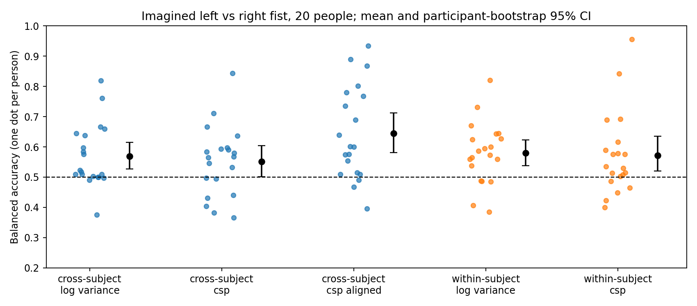

# EEG motor-imagery decoding across people

Can 8–30 Hz scalp EEG tell imagined left-fist from imagined right-fist movement in a person the decoder has never seen? This notebook tests that question on public data, with the analysis plan fixed before the data were analysed.

**Data:** [PhysioNet EEG Motor Movement/Imagery Dataset](https://physionet.org/content/eegmmidb/1.0.0/), imagery runs 4, 8 and 12 of subjects 1–20 (64 channels, 160 Hz; 45 trials per person, 900 in total). The data are downloaded when the notebook runs and are not stored here.

**Primary test (fixed in advance):** CSP + logistic regression, leave-one-subject-out. Each person's balanced accuracy is tested against 0.5 across people with a two-sided Wilcoxon signed-rank test, α = .05.

## Results

| Analysis | Model | Mean balanced accuracy (95% CI) | Wilcoxon p vs 0.5 | People individually above chance |
|---|---|---|---:|---:|
| Cross-subject | **CSP (primary)** | **0.552 (0.50–0.60)** | **.097** | 4 / 20 |
| Cross-subject | Log-variance baseline | 0.569 (0.53–0.61) | .004 | 6 / 20 |
| Cross-subject | CSP after Euclidean alignment | 0.645 (0.58–0.71) | < .001 | 9 / 20 |
| Within-subject (leave one run out) | Log-variance baseline | 0.579 (0.54–0.62) | .003 | 5 / 20 |
| Within-subject (leave one run out) | CSP | 0.572 (0.52–0.63) | .028 | 4 / 20 |

Intervals are participant-bootstrap 95% intervals. "Individually above chance" means a one-sided binomial test at α = .05, which needs about 64% correct with 45 trials.



- **The primary test was not significant.** Unaligned CSP did not decode imagined hand movement in new people reliably above chance (mean 0.552, p = .097). With the observed spread between people (SD 0.116), detecting a mean of 0.55 with 80% power would need about 40 people, not 20. This estimate is approximate.
- **Euclidean alignment helped.** Re-centring each person's covariances before CSP ([He & Wu, 2020](https://arxiv.org/abs/1808.05464)) raised balanced accuracy by 9.3 points (paired Wilcoxon p = .001), and 17 of 20 people improved. Alignment uses the held-out person's unlabelled trials, including those being classified, so in a real interface it would need an unlabelled calibration recording first.
- **Within-subject decoding was not better than cross-subject decoding here** (CSP 0.572 vs 0.552, p = .62). Each within-subject model trains on only 30 trials across 64 channels, compared with 855 trials for each cross-subject model, so this comparison mixes the question being asked with the amount of training data.
- Seven secondary tests are reported without correction. Aligned CSP, both log-variance results and the alignment effect remain significant after a Bonferroni correction across the seven; within-subject CSP does not.

## Limits

- **The label is confounded with where the target appears.** In these runs the target appears on the left or right of the screen, and the person imagines the matching fist. Lateralized visual attention (posterior alpha, inside the 8–30 Hz band) or small eye movements could carry the label as well as motor imagery does. This analysis does not separate them. Restricting the decoder to sensorimotor channels, or inspecting the CSP spatial patterns, would be the first check.
- No artifact rejection or ICA; one frequency band and one time window, both fixed in advance and not tuned.
- 20 of 109 participants. This is an offline exploratory decoder, not an assistive device.

## Files

| File | Contents |
|---|---|
| `01_EEG_Motor_Imagery_BCI.ipynb` | The notebook, executed in Google Colab, with the analysis plan in its first cell |
| `results/accuracy_by_person.png` | Balanced accuracy for each person, every analysis |
| `tests/test_01_synthetic.py` | Runs the notebook's evaluation cells on synthetic EEG with a planted signal and person-specific mixing. It checks that within-subject decoding finds the signal, that alignment helps cross-subject decoding, and that every output is written |

## Run

Open the notebook in Google Colab and run all cells; the download of 60 recordings from PhysioNet takes most of the time. To run the synthetic check locally:

```bash
pip install -r requirements.txt
python tests/test_01_synthetic.py
```

## How this was made

Mansi Agarwal built the original notebook: data loading and labelling, preprocessing, the log-variance and CSP decoders, the figures and the interpretation checklist. Before the first run on real data, Claude (Anthropic) revised the evaluation. The revisions added leave-one-subject-out testing across 20 people, within-subject leave-one-run-out testing, Euclidean alignment, tests across people and the fixed analysis plan. Claude also wrote the synthetic-data test. The notebook was run three times. The first run stopped at an interactive MNE prompt; the second completed. The third followed two cosmetic changes (a renamed montage and a print format) and reproduced the second run's results exactly.

## References

- Schalk, G., McFarland, D. J., Hinterberger, T., Birbaumer, N., & Wolpaw, J. R. (2004). BCI2000: a general-purpose brain-computer interface (BCI) system. *IEEE Transactions on Biomedical Engineering*, 51(6), 1034–1043.
- Goldberger, A. L., et al. (2000). PhysioBank, PhysioToolkit, and PhysioNet. *Circulation*, 101(23), e215–e220.
- He, H., & Wu, D. (2020). Transfer learning for brain-computer interfaces: a Euclidean space data alignment approach. *IEEE Transactions on Biomedical Engineering*, 67(2), 399–410.

## License

Code: MIT (see `LICENSE`). Text and figures: CC BY 4.0. The EEG data are not redistributed; they remain under the PhysioNet dataset's license.
