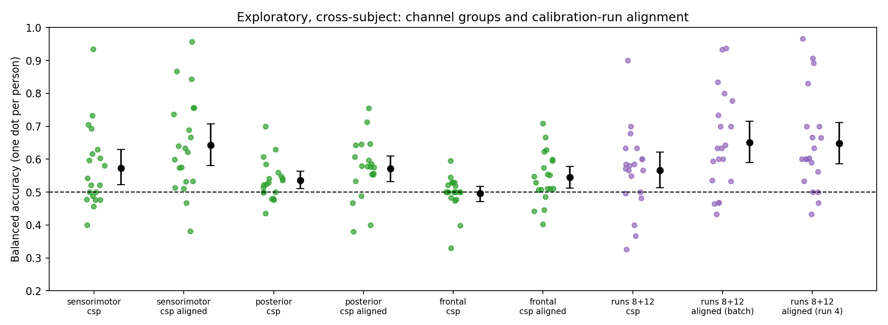

# EEG motor-imagery decoding across people

Can 8–30 Hz scalp EEG tell imagined left-fist from imagined right-fist movement in a person the decoder has never seen? This notebook tests that question on public data, with the analysis plan fixed before the data were analysed.

**Data:** [PhysioNet EEG Motor Movement/Imagery Dataset](https://physionet.org/content/eegmmidb/1.0.0/), imagery runs 4, 8 and 12 of subjects 1–20 (64 channels, 160 Hz; 45 trials per person, 900 in total). The data are downloaded when the notebook runs and are not stored here.

**Primary test (fixed in advance):** CSP + logistic regression, leave-one-subject-out. Each person's balanced accuracy is tested against 0.5 across people with a two-sided Wilcoxon signed-rank test, α = .05.

## Results

| Analysis | Model | Mean balanced accuracy (95% CI) | Wilcoxon p vs 0.5 | People individually above chance |
|---|---|---|---:|---:|
| Cross-subject | **CSP (primary)** | **0.552 (0.50–0.60)** | **.097** | 4 / 20 |
| Cross-subject | Log-variance baseline | 0.569 (0.53–0.61) | .004 | 6 / 20 |
| Cross-subject | CSP after Euclidean alignment | 0.645 (0.58–0.71) | < .001 | 9 / 20 |
| Within-subject (leave one run out) | Log-variance baseline | 0.579 (0.54–0.62) | .003 | 5 / 20 |
| Within-subject (leave one run out) | CSP | 0.572 (0.52–0.63) | .028 | 4 / 20 |

Intervals are participant-bootstrap 95% intervals. "Individually above chance" means a one-sided binomial test at α = .05, which needs about 64% correct with 45 trials.


- **The primary test was not significant.** Unaligned CSP did not decode imagined hand movement in new people reliably above chance (mean 0.552, p = .097). With the observed spread between people (SD 0.116), detecting a mean of 0.55 with 80% power would need about 40 people, not 20. This estimate is approximate.
- **Euclidean alignment helped.** Re-centring each person's covariances before CSP ([He & Wu, 2020](https://arxiv.org/abs/1808.05464)) raised balanced accuracy by 9.3 points (paired Wilcoxon p = .001), and 17 of 20 people improved. Here alignment uses the held-out person's unlabelled trials, including those being classified. An exploratory check below computes it from a separate calibration run instead, with the same result.
- **Within-subject decoding was not better than cross-subject decoding here** (CSP 0.572 vs 0.552, p = .62). Each within-subject model trains on only 30 trials across 64 channels, compared with 855 trials for each cross-subject model, so this comparison mixes the question being asked with the amount of training data.
- Seven secondary tests are reported without correction. Aligned CSP, both log-variance results and the alignment effect remain significant after a Bonferroni correction across the seven; within-subject CSP does not.

## Exploratory analyses (added after review)

Added on 28 October 2026, after the results above had been seen and reviewed. They are not part of the analysis plan and are reported descriptively, without correction for the additional tests. Same 20 people, leave-one-subject-out.

**Where is the decodable signal?** Cross-subject CSP restricted to channel groups defined by electrode row. Each group is re-referenced to its own average, so activity outside the group cannot enter through the reference.

| Channels | CSP: mean balanced accuracy (Wilcoxon p) | CSP after alignment | People above chance, aligned |
|---|---|---|---:|
| All 64 (planned analysis) | 0.552 (.097) | 0.645 (< .001) | 9 / 20 |
| Sensorimotor: FC, C and CP rows (21) | 0.573 (.026) | 0.643 (< .001) | 9 / 20 |
| Posterior: P, PO, O and Iz (18) | 0.535 (.012) | 0.572 (.004) | 5 / 20 |
| Frontal: Fp, AF and F rows (17) | 0.497 (.64) | 0.545 (.022) | 2 / 20 |

- **Sensorimotor channels carry most of what is decodable.** After alignment they match the full montage (0.643 vs 0.645) and beat posterior channels by 7.1 points (paired p = .005, 16 of 20 people). Without alignment the difference is 3.7 points (p = .25).
- **The visual-cue confound is not ruled out.** Posterior channels alone still decode above chance (0.572 after alignment, p = .004), which is what lateralized visual attention would produce. Frontal channels, where eye movements would show most, are at chance without alignment and slightly above it with alignment. Volume conduction spreads activity across the scalp, so channel groups are not sources; this localizes the signal only roughly.

**Alignment from a separate calibration run.** The held-out person's alignment is computed from their first imagery run alone (run 4, 15 unlabelled trials), and every decoder is scored on the same 30 trials from runs 8 and 12.

| Alignment for the held-out person | Mean balanced accuracy (95% CI) | Wilcoxon p vs 0.5 | People above chance |
|---|---|---:|---:|
| None | 0.566 (0.51–0.62) | .040 | 3 / 20 |
| From all of their trials, including those being classified (as above) | 0.651 (0.59–0.72) | < .001 | 8 / 20 |
| From run 4 only | 0.648 (0.59–0.71) | < .001 | 8 / 20 |

- **Batch alignment was not optimistic here.** Alignment from a separate 15-trial run matched alignment from all trials (difference −0.4 points, p = .98) and beat no alignment by about 8 points (p < .01, 14 of 20 people). With 30 trials, about 67% correct is needed for one person to differ from chance.
- The calibration run comes from the same session, so this does not show how well alignment carries over to another day.



## Limits

- **The label is confounded with where the target appears.** In these runs the target appears on the left or right of the screen, and the person imagines the matching fist. Lateralized visual attention (posterior alpha, inside the 8–30 Hz band) or small eye movements could carry the label as well as motor imagery does. The channel-group analysis above is a first check, not a resolution. Separating imagery from cue-related activity needs an analysis or a task built for it, such as source-level decoding or a centrally presented cue.
- No artifact rejection or ICA; one frequency band and one time window, both fixed in advance and not tuned.
- 20 of 109 participants. This is an offline exploratory decoder, not an assistive device.

## Files

| File | Contents |
|---|---|
| `01_EEG_Motor_Imagery_BCI.ipynb` | The notebook, executed in Google Colab, with the analysis plan in its first cell |
| `results/accuracy_by_person.png`, `results/exploratory_by_person.png` | Balanced accuracy for each person: planned and exploratory analyses |
| `results/cross_subject_by_person.csv`, `results/within_subject_by_person.csv`, `results/exploratory_by_person.csv` | One row per person and analysis: trials, correct, accuracy, balanced accuracy, ROC AUC |
| `results/summary.csv`, `results/paired_comparisons.csv` | Tests across people for the planned analyses |
| `results/exploratory_summary.csv`, `results/exploratory_paired_comparisons.csv` | The same for the exploratory analyses |
| `results/run_inventory.csv` | Epochs and class counts per person and run |
| `results/settings.json`, `results/exploratory_settings.json` | Settings, package versions, channel groups and the calibration run |
| `tests/test_01_synthetic.py` | Runs the notebook's evaluation cells on synthetic EEG with a planted signal and person-specific mixing. Ten checks: within-subject decoding finds the signal; alignment helps cross-subject decoding, including from a separate calibration run; the channel groups contain the intended electrodes and locate the planted signal; every output is written |

## Run

Open the notebook in Google Colab and run all cells; the download of 60 recordings from PhysioNet takes most of the time. To run the synthetic check locally:

```bash
pip install -r requirements.txt
python tests/test_01_synthetic.py
```

## How this was made

Mansi Agarwal built the original notebook: data loading and labelling, preprocessing, the log-variance and CSP decoders, the figures and the interpretation checklist. Before the first run on real data, Claude (Anthropic) revised the evaluation. The revisions added leave-one-subject-out testing across 20 people, within-subject leave-one-run-out testing, Euclidean alignment, tests across people and the fixed analysis plan. Claude also wrote the synthetic-data test and, after review, the two exploratory analyses. The planned analyses produced identical results in every completed run. The first run stopped at an interactive MNE prompt; the second completed. The third followed two cosmetic changes (a renamed montage and a print format). Later runs added the exploratory cells; the published run is a clean rerun of the final version.

## References

- Schalk, G., McFarland, D. J., Hinterberger, T., Birbaumer, N., & Wolpaw, J. R. (2004). BCI2000: a general-purpose brain-computer interface (BCI) system. *IEEE Transactions on Biomedical Engineering*, 51(6), 1034–1043.
- Goldberger, A. L., et al. (2000). PhysioBank, PhysioToolkit, and PhysioNet. *Circulation*, 101(23), e215–e220.
- He, H., & Wu, D. (2020). Transfer learning for brain-computer interfaces: a Euclidean space data alignment approach. *IEEE Transactions on Biomedical Engineering*, 67(2), 399–410.

## License

Code: MIT (see `LICENSE`). Text and figures: CC BY 4.0. The EEG data are not redistributed; they remain under the PhysioNet dataset's license.
